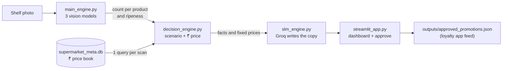

# FreshGuard AI

**Snap a photo of a produce bin. Get the count, the freshness and the right price in seconds.**

FreshGuard AI is a Streamlit prototype for supermarket fresh produce. A store manager uploads one photo of a fruit or vegetable bin, and FreshGuard:

1. **counts** every item and works out what it is (36 fruits and vegetables),
2. **grades** each one as *Unripe*, *Ripe*, *Overripe* or *Rotten*,
3. **decides** what the store should do (mark down, bundle, hold back, or leave as is) and at what **₹ price**, never below cost,
4. **writes** the promotion text for the loyalty app with a Groq-hosted small language model (SLM),
5. lets the manager **approve** the deals with one click.

> **Golden rule:** math sets the price, the AI only writes the words, and a human approves before anything goes out.

Built by **TeamRocket** for the Tredence Hackathon.

---

## Contents

- [Why we built it](#why-we-built-it)
- [Scope and assumptions](#scope-and-assumptions)
- [How it works](#how-it-works)
- [Step 1: the vision models](#step-1-the-vision-models-main_enginepy)
- [Step 2: the price database](#step-2-the--price-database-init_dbpy)
- [Step 3: the decision engine](#step-3-the-decision-engine-decision_enginepy)
- [Step 4: the SLM copywriter](#step-4-the-slm-copywriter-slm_enginepy)
- [Step 5: the dashboard](#step-5-the-dashboard-streamlit_apppy)
- [Worked example](#worked-example-sample_datapicpng)
- [Quick start](#quick-start)
- [Configuration](#configuration)
- [Testing](#testing)
- [Project structure](#project-structure)
- [Performance](#performance)
- [Known limitations](#known-limitations)
- [Roadmap](#roadmap)
- [Team](#team)

---

## Why we built it

Packaged food carries a printed expiry date. A banana or a tomato does not. So in most stores:

- **Freshness is checked by eye.** Staff walk the aisles and guess which bins are turning. It is slow and easy to miss.
- **Discounts come late, or too wide.** Markdowns happen after the fruit is already soft, or as a blanket cut on the whole bin that throws away margin.
- **Promotions are written by hand.** Nobody has time to write a fresh deal for every bin, every day.

FreshGuard turns one photo into a counted, graded inventory and a ready-to-approve action plan.

## Scope and assumptions

- **Fresh produce only (fruits and vegetables).** Dairy, bread and packaged goods already have a printed expiry date, and the pack hides the product, so image detection adds little there. Loose produce shows its freshness only on its surface, which is exactly what a camera can see.
- **One photo = one bin or shelf section.** The counts and prices are for what is visible in that photo.
- **Prices are illustrative** demo values in Indian rupees, stored per unit the camera counts (per piece for large produce, per pack or bunch for small produce).
- **A human stays in the loop.** Nothing reaches customers until the manager clicks *Approve*.

---

## How it works



In code, the call chain runs top-down and passes plain Python dictionaries between modules (no intermediate files):

```
streamlit_app.py  ->  slm_engine.py  ->  decision_engine.py  ->  main_engine.py
     (screen)          (copywriter)          (brain)               (eyes)
```

`config.py` holds every path, threshold and setting in one place, and `init_db.py` builds the ₹ price database.

---

## Step 1: the vision models (`main_engine.py`)

`ShelfInventoryPipeline.process_shelf_image(image_path)` runs three models. Each one answers a single question.

| Stage | Model and weights file | Its job | Why we chose it |
|---|---|---|---|
| 1. **Where?** | YOLOv8 detector trained on SKU-110K, `sku110k_yolo.pt` | Draw a box around every item | SKU-110K is a dataset of densely packed supermarket shelves, so the detector is used to crowded scenes. It is one fast pass over the image. |
| 2A. **What?** | VGG16 classifier, `vgg.h5` | Name each box as 1 of 36 fruits and vegetables | A proven transfer-learning backbone that is simple to fine-tune and well understood. |
| 2B. **How fresh?** | YOLOv8-cls classifier, `freshguard_4class_ripeness_20ep.pt` | Grade each box: Unripe, Ripe, Overripe or Rotten | Small and fast, and it uses the same Ultralytics toolkit as the detector. |

**Key settings and the reasons behind them**

- **Detector confidence = 0.15** (IoU 0.45, up to 300 boxes). A low bar on purpose: missing an item is worse than checking one extra box.
- **Boxes of 15 px or smaller are dropped** as noise.
- **Each box is cropped** and resized to 224 × 224 pixels for the two classifiers (VGG16 also scales colours to 0–1).
- **Skip, don't guess:** if VGG16 is less than **35 %** sure of the product, that crop is dropped. A wrong label would lead to a wrong price.
- **Steps 2A and 2B run in parallel** on two threads (measured 0.53 s → 0.30 s for the classifier stage).
- **Crops go to the ripeness model in groups of 32**, because Ultralytics ignores its `batch=` argument when given a Python list.

**Why three models instead of one?** "Where", "what" and "how fresh" are separate problems. Keeping them apart means any one model can be retrained or swapped without touching the others.

**Output contract** (these six key names are frozen; everything downstream relies on them):

```python
{
    "Apple": {
        "Product_Type": "Apple",
        "Product_Count": 31,
        "Ripe_Count": 28,
        "Unripe_Count": 0,
        "Overripe_Count": 0,
        "Rotten_Count": 3,
    },
    # ... one entry per product found in the photo
}
```

---

## Step 2: the ₹ price database (`init_db.py`)

A small SQLite file, `supermarket_meta.db`, acts as the store's price book. Table `produce_pricing_meta` has one row per produce class (all 36) and six columns:

| Column | Meaning |
|---|---|
| `product_type` | Name, exactly as the vision model outputs it |
| `base_price` | Normal selling price (₹) |
| `cost_price` | What the store paid (₹). Prices never go below this. |
| `max_discount_pct` | Largest markdown allowed, e.g. `0.50` = 50 % off |
| `target_capacity` | How many units the bin should normally hold. Used to detect overstock. |
| `price_elasticity` | Demand sensitivity. Stored for future use; **not used yet**. |

Sample rows:

| Product | Base | Cost | Max discount | Target stock | Unit |
|---|---:|---:|---:|---:|---|
| Apple | ₹36 | ₹18 | 50 % | 20 | piece |
| Banana | ₹7 | ₹2.50 | 60 % | 40 | piece |
| Orange | ₹15 | ₹7.50 | 50 % | 15 | piece |
| Grapes | ₹60 | ₹29 | 55 % | 20 | 500 g pack |
| Tomato | ₹6 | ₹2.50 | 40 % | 30 | piece |
| Watermelon | ₹70 | ₹33 | 50 % | 10 | piece |

**Design choices**

- **One query per scan.** The decision engine fetches every product in the photo at once with `WHERE product_type IN (...)`, never one query per product.
- **Self-healing.** If the database is missing, or was built in another currency (an old `$` version), it is rebuilt in rupees automatically. A `db_meta` table records `currency=INR` and the seed version.
- **Offline fallback.** If the database cannot be read at all, the same seed numbers are used from memory, so a demo never crashes.

---

## Step 3: the decision engine (`decision_engine.py`)

`DecisionEngine.evaluate_inventory(inventory)` turns the counts into four simple numbers per product.

**1. Sellable stock.** Rotten items can't be sold, so they never count as stock.

$$S = N_{ripe} + N_{unripe} + N_{overripe}$$

**2. Ripeness Index (RI).** One freshness score for the whole bin, from 0 (all green) to 1 (all overripe).

$$RI = \frac{0 \cdot N_{unripe} + 0.5 \cdot N_{ripe} + 1.0 \cdot N_{overripe}}{S}$$

*Why linear weights 0 / 0.5 / 1?* They give a single number that is easy to explain to a store manager. The cut-offs at 0.35 and 0.65 split it into roughly three bands: green, balanced, and going soft.

**3. Overstock flag.**

$$\text{overstocked} = S > \text{target capacity}$$

**4. Markdown price** (used only when stock is deteriorating).

$$P_{new} = \max\big(P_{cost},\ \text{round}(P_{base} \times (1 - D_{max}),\ 2)\big)$$

*Why this formula?* The discount is capped by store policy (`max_discount_pct` from the database), and the store never sells below cost. Example for apples: max(₹18, ₹36 × 0.5) = **₹18**.

**Five scenarios, checked in order (the first match wins):**

| Scenario | When it fires | What the store does | Price |
|---|---|---|---|
| **Rotten only** | Nothing sellable, only rotten items | Cull the bin and sanitise the shelf | n/a |
| **A · Deteriorating** | Overripe ≥ 15 %, **or** RI ≥ 0.65, **or** any rotten | Remove rotten units, mark down, recipe-led promo (smoothies, baking, sauces) | Markdown |
| **B · Fresh but overstocked** | Over target stock **and** fresh (Ripe ≥ 60 % or 0.35 ≤ RI < 0.65) | Bundle, pair with complementary items, front-of-store end-cap | Full price |
| **C · Unripe hold** | Unripe ≥ 50 % **or** RI < 0.35 | "Eat Now, Ripen Later" packs, rotate extra stock to cold storage | Full price |
| **D · Optimal** | None of the above | Standard farm-fresh loyalty push | Full price |

Only scenario A cuts the price. B, C and D protect margin. All thresholds live in `config.py`, so a store can tune them.

---

## Step 4: the SLM copywriter (`slm_engine.py`)

`SLMEngine.generate_recommendations(image_path)` runs the vision and decision steps, then asks a small language model on **Groq** to write the human-facing text:

- **`strategy`**: a 3–4 sentence instruction for store staff,
- **`loyalty_message`**: the customer-facing promo for the loyalty app,
- **`combo_pitch`**: a short pitch for each bundle.

**Guardrails**

- **The model never sets a price.** It receives the engine's fixed facts (scenario, counts, ₹ prices, bundle offer) and only writes words.
- **Price guard.** `_copy_is_safe()` rejects any reply that mentions a price or percentage the engine did not calculate, or uses the wrong currency (`$`, `€`, `£`). `₹`, `Rs` and `INR` are accepted.
- **Offline fallback.** With no API key, no internet or any Groq error, ready-made template text is used and the dashboard shows a warning. The demo keeps working.
- **Caching.** The same photo is not re-scanned, and identical Groq requests are answered from a cache.

**Models** (Groq-hosted): `qwen/qwen3.8-27b` first, then `meta-models/muse-spark-open` if the first is unavailable. We use JSON mode so replies are structured.

*Why Groq and a small model?* Groq returns replies very fast and supports JSON mode, and short shelf copy does not need a giant model.

---

## Step 5: the dashboard (`streamlit_app.py`)

A white-and-green "produce command centre":

- **Sidebar:** upload a photo (`png`, `jpg`, `jpeg`), click **Analyze bin**, and see whether the models are loaded.
- **Summary strip:** items counted, products found, rotten units to remove, markdowns to approve.
- **Five tabs:**
  - **Inventory**: a ripeness bar per product and a plain-language shelf status (*Cull whole bin*, *Mark down now*, *Overstocked, bundle it*, *Ripening, hold back*, *Healthy*), plus scan timings.
  - **Store actions**: the staff instructions.
  - **Promotions**: shelf-edge style price tags with the loyalty message, and the **Approve and send to loyalty app** button, which appends to `outputs/approved_promotions.json`.
  - **Bundles**: combo offers with their pitch.
  - **Raw output**: the full JSON for debugging.

---

## Worked example (`sample_data/pic.png`)

The sample photo shows a bin of apples next to a bin of oranges. Its hand count is stored in `sample_data/pic_inventory.json`.

| Product | Count | Ripeness | Scenario | Price | Action |
|---|---:|---|---|---|---|
| Apple | 31 | 28 ripe, 3 rotten | **A · Deteriorating** (any rotten) | ₹36 → **₹18** | Remove 3 rotten, mark down, "bake a cinnamon apple crumble" promo |
| Orange | 12 | 12 ripe | **D · Optimal** (12 < target 15) | **₹15** | Standard "farm fresh" push |

Result: **2 promotions + 1 bundle** (an Apple "Eat Now & Bake Later" value bag).

Example SLM output: *"Apples are 50% off today at just ₹18 – bake a cinnamon apple crumble tonight!"*

> These numbers use the hand-counted inventory (demo mode), so the business logic can be checked against a known answer. See [Known limitations](#known-limitations) for how the real detector does on this photo.

---

## Quick start

### 1. Requirements

- Python **3.12** (developed on Windows 11 with VS Code; Linux and macOS also work)
- About 3 GB of free disk space for PyTorch, TensorFlow and Ultralytics
- A free Groq API key from <https://console.groq.com/keys> (optional; without it the template text is used)

### 2. Install

```bash
python -m venv .venv
# Windows (PowerShell):  .venv\Scripts\activate
# Windows (Git Bash):    source .venv/Scripts/activate
# macOS / Linux:         source .venv/bin/activate
pip install -r requirements.txt
```

### 3. Add the model weights

Put these three files in the project folder, next to `main_engine.py` (or point `FRESHGUARD_WEIGHTS_DIR` to another folder):

| File | Model |
|---|---|
| `sku110k_yolo.pt` | YOLOv8 SKU-110K detector |
| `vgg.h5` | VGG16 produce classifier (36 classes) |
| `freshguard_4class_ripeness_20ep.pt` | YOLOv8-cls ripeness classifier |

> `sku110k_yolo.pt` must be a **YOLOv8** file. A YOLOv5 file fails with *"not forwards compatible with YOLOv8"*. If the detector file is missing, the app downloads the public SKU-110K YOLOv8n weights from Hugging Face under that name.

The weight files are git-ignored (`*.pt`, `*.h5`).

### 4. Add your Groq key

```bash
cp .env.example .env        # Windows PowerShell: copy .env.example .env
```

Open `.env` and set `GROQ_API_KEY=gsk_...`. The file must be named exactly **`.env`** (with the leading dot). Some browsers drop the dot when you download it. Restart the app after changing it. Never commit `.env`.

### 5. Run

Run commands from the folder that contains `streamlit_app.py`.

```bash
streamlit run streamlit_app.py      # opens http://localhost:8501
# or simply:  python streamlit_app.py   (relaunches itself under Streamlit)
```

Other ways to run it:

```bash
python run_pipeline.py              # whole chain on sample_data/pic.png, prints per-stage timings
python run_pipeline.py my_bin.jpg   # your own photo
python run_pipeline.py --sample     # no vision models: uses the hand-counted inventory
python init_db.py                   # (optional) build the ₹ database now; the app also builds it on first run
```

**Demo safety net:** set `FRESHGUARD_SAMPLE_MODE=1` (in `.env` or the shell) to skip the vision models and use the hand-counted `pic.png` inventory. This is useful on a laptop without the weights.

---

## Configuration

Everything lives in `config.py`, and the settings below can be overridden with environment variables or `.env`.

| Variable | Default | What it does |
|---|---|---|
| `GROQ_API_KEY` | (empty) | Groq key. Empty → template copy plus a warning. |
| `FRESHGUARD_GROQ_MODELS` | `qwen/qwen3.8-27b,meta-models/muse-spark-open` | Models tried in order |
| `FRESHGUARD_GROQ_TIMEOUT` | `30` | Groq timeout in seconds |
| `FRESHGUARD_SAMPLE_MODE` | `0` | `1` = use the hand-counted inventory, no vision models |
| `FRESHGUARD_PRELOAD` | `1` | Load and warm up the models in the background when the app starts |
| `FRESHGUARD_PARALLEL` | `1` | Run the two classifiers at the same time |
| `FRESHGUARD_USE_FAST_MODELS` | `0` | Use OpenVINO exports of the YOLO models (benchmark first, see below) |
| `FRESHGUARD_WEIGHTS_DIR` | project folder | Where the weight files are |
| `FRESHGUARD_DB_PATH` | `./supermarket_meta.db` | Database location |
| `FRESHGUARD_MIN_PRODUCE_CONF` | `0.35` | Minimum VGG16 confidence to keep a crop |
| `FRESHGUARD_CURRENCY` / `FRESHGUARD_CURRENCY_CODE` | `₹` / `INR` | Currency symbol and code |

Business thresholds (overripe alert 15 %, ripe peak 60 %, unripe hold 50 %, RI cut-offs 0.35 / 0.65) and detector settings are constants in `config.py`.

---

## Testing

```bash
pytest -q
```

- **40 offline tests** use fake models and a fake Groq client. They need no weights, no GPU and no internet, and they never call the real Groq API. They cover the output contract, every scenario, the markdown cost floor, the single database query, the price guard, the dashboard (Streamlit `AppTest`), the `python streamlit_app.py` launcher, Windows console encoding and non-ASCII file paths.
- **4 real-weight tests** (`tests/test_real_weights.py`) run the actual models on `pic.png`. They are skipped automatically when the weight files are missing.

Expected result: `40 passed, 4 skipped` without weights, and 44 tests run with them.

---

## Project structure

```
fg_v6/
├── streamlit_app.py        # dashboard: upload, 5 tabs, approve → outputs/approved_promotions.json
├── slm_engine.py           # SLMEngine: Groq copywriter, price guard, offline templates, caching
├── decision_engine.py      # DecisionEngine: S, RI, overstock, markdown, 5 scenarios, 1 DB query
├── main_engine.py          # ShelfInventoryPipeline: YOLO detector + VGG16 + YOLO-cls ripeness
├── init_db.py              # builds supermarket_meta.db (36 classes, ₹ prices)
├── config.py               # all paths, thresholds and settings (env-overridable)
├── run_pipeline.py         # command-line run with per-stage timings
├── optimize_models.py      # optional: export YOLO models to OpenVINO and benchmark
├── requirements.txt
├── .env.example            # copy to .env and add GROQ_API_KEY
├── .streamlit/config.toml  # white + green theme
├── .vscode/launch.json     # F5 configs: dashboard, CLI, pytest
├── sample_data/
│   ├── pic.png             # sample bin photo
│   └── pic_inventory.json  # hand-counted ground truth for pic.png
├── tests/                  # 40 offline tests + 4 real-weight tests
├── CLAUDE.md               # detailed architecture and data contracts
└── (weights)               # sku110k_yolo.pt, vgg.h5, freshguard_4class_ripeness_20ep.pt
```

Created at runtime (git-ignored): `supermarket_meta.db`, `uploads/`, `outputs/`.

---

## Performance

Measured on our test machine (CPU only):

| Improvement | Before | After |
|---|---|---|
| Models loaded in the background at app start | first scan 13.1 s | first scan **0.5 s** |
| Produce and ripeness classifiers run in parallel | 0.53 s | **0.30 s** |
| Page ready while the models load | 14 s | **4.2 s** |
| Database | one query per product | **one query per scan** |

Re-scanning the same photo reuses the earlier result. `python run_pipeline.py` prints how long each stage took on your own machine. `python optimize_models.py` tests whether OpenVINO is faster on your CPU. Turn it on with `FRESHGUARD_USE_FAST_MODELS=1` only if the benchmark shows a gain (it was slower in our sandbox).

---

## Known limitations

We prefer to state these plainly:

- **The detector undercounts crowded bins.** On `pic.png` it found 16 boxes where a person counts 43. SKU-110K was trained on packaged shelf products, not heaps of loose fruit.
- **Accuracy is only measured on one labelled photo.** More hand-counted images are needed for real precision and recall numbers.
- **36 produce classes only.** Avocado and strawberry, for example, are not recognised.
- **One rotten item triggers scenario A for the whole bin**, which applies the full markdown even to fresh units.
- **`price_elasticity` is stored but not used yet.** Discount depth does not consider demand.
- **VGG16 is the slowest step on CPU**, and TensorFlow is a heavy dependency.
- **Prices are demo values**, not real store data.
- **The loyalty app is a mock.** Approved promotions are written to a JSON file.

## Roadmap

- Fine-tune the detector on real produce-bin photos, and tile large photos so small items are detected.
- Retrain the produce classifier with more classes, using store data.
- Change the rotten rule: cull rotten units first, and scale the markdown by the share of overripe stock.
- Use `price_elasticity` and sales history to choose the discount depth.
- Convert `vgg.h5` to ONNX or a YOLOv8-cls model to drop TensorFlow and speed up CPU inference.
- Connect to a real loyalty platform and to electronic shelf labels.

The pipeline is built so it gets better with more data. Each model can be retrained on a retailer's own photos without changing the rest of the system, because every stage communicates through the same six-field count.

---

## Team

**TeamRocket**, Tredence Hackathon

| Part | Files |
|---|---|
| Vision models and decision engine | `main_engine.py`, `decision_engine.py` |
| SLM promo engine | `slm_engine.py` |
| Frontend and ₹ database | `streamlit_app.py`, `init_db.py` |
